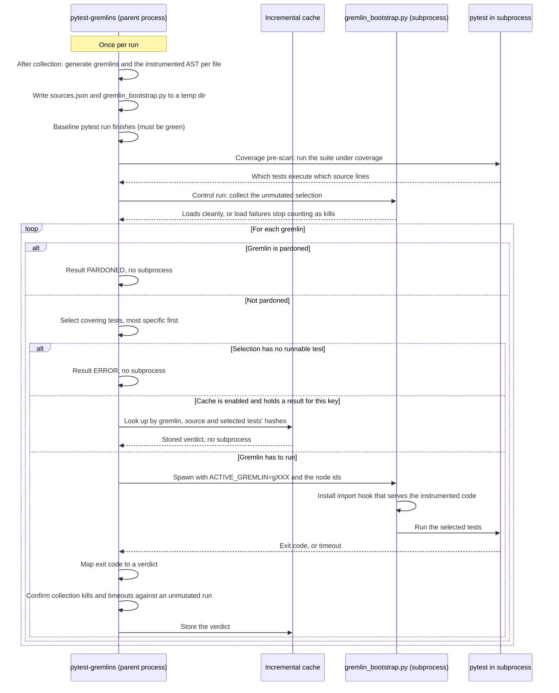

# The Gremlin Execution Loop

This page describes what pytest-gremlins does internally for each gremlin during a
`--gremlins` run. It is a description of **engine internals**, not of the workflow you follow as
a user. As a user you run `pytest --gremlins` and read the report; everything below happens inside that
one command.

The technique is: instrument the source once with every mutation embedded, then select the
active mutation at runtime with an environment variable. The diagram shows where that selection
happens and what else happens around it.

## The Default Loop

The diagram shows the default path: gremlins run one after another, each in its own
subprocess. It leaves out reporting and the end-of-run steps.

Every gremlin that actually runs gets a fresh subprocess and a real pytest run. Nothing about a
gremlin is cheap because of "no process" or "no I/O". It is cheap because the source was
instrumented once up front and because only the tests that cover its line are run.

## The Steps

### Once per run

1. **Instrument once.** Right after test collection (`pytest_collection_finish`), the operators
   produce the gremlins and one instrumented AST per target file that carries all of them. Each
   mutation site checks the `__gremlin_active__` variable, which the instrumented module sets
   from the `ACTIVE_GREMLIN` environment variable when it is imported. See
   [Mutation Switching](mutation-switching.md). Under pytest-xdist the controller has no test
   items at that point, so this step moves to the end of the run.
2. **Write the bootstrap.** The instrumented sources go into `sources.json` in a temporary
   directory, next to a generated `gremlin_bootstrap.py`. The bootstrap registers an import
   hook and then runs pytest. The original files on disk are never modified.
3. **Baseline.** The ordinary pytest run executes. When it ends, `pytest_sessionfinish` starts
   mutation testing only if the baseline is green; otherwise the plugin skips it and says why.
4. **Coverage pre-scan.** The suite runs once under coverage with a context per test. The result
   is a map from source lines to the tests that execute them. See
   [Coverage Guidance](coverage-guidance.md).
5. **Control run.** Before the first gremlin, the plugin collects the unmutated selection through
   the same bootstrap. If that already fails to load, a load failure under a mutant can no
   longer be attributed to the mutant, so such failures are scored as errors instead of kills.

### For each gremlin

1. **Pardon check.** A pardoned gremlin gets the `PARDONED` verdict and runs nothing.
2. **Test selection.** The map from the pre-scan yields the tests covering the gremlin's line,
   with the tests that cover the fewest lines first. If nothing covers the line, the whole suite
   is selected. A selected name with no pytest node id cannot be run; if that leaves nothing,
   the gremlin gets `ERROR` and runs nothing.
3. **Cache lookup.** With `--gremlin-cache` the key is built from the gremlin, the source hash,
   the hashes of the selected tests' files and the run settings (mutant timeout, optimize level,
   rerun settings). A hit returns the stored verdict and runs nothing. See
   [Incremental Analysis](incremental-analysis.md).
4. **Spawn.** The plugin starts `gremlin_bootstrap.py` as a subprocess, with `ACTIVE_GREMLIN`
   set to the gremlin's id and the selected node ids passed to pytest. A timeout bounds the run.
5. **Run.** In the subprocess, the import hook serves the instrumented module. The mutation
   site sees its gremlin id in `__gremlin_active__` and executes the mutated path.
6. **Verdict.** The plugin reads the exit code:

    | Outcome | Verdict |
    | ------- | ------- |
    | Exit 0, tests passed | `SURVIVED` |
    | Exit 1, a test failed | `ZAPPED` |
    | The suite could not be collected under the mutant | `ZAPPED`, recorded as a collection kill |
    | Any other exit code | `ERROR` |
    | The run outlasted the timeout | `TIMEOUT` |

7. **Confirmation.** A collection kill is kept only if the gremlin's own selection also
   loads without a mutant. A timeout is kept only if that selection finishes without a mutant
   within half of the timeout. If it takes longer than that, does not finish, or cannot be
   launched, the verdict becomes `ERROR`, which still counts against the score.
8. **Store.** The verdict goes into the cache, with these exceptions: nothing is stored after
   a failed control run, or when the source file or a selected test file has no hash. Errors
   that depend on a harness or configuration problem you have to fix first are not stored either.

How each verdict is scored is covered in [Verdicts](../guide/verdicts.md).

## Workers and Batches

The loop above is the default. Two options change how steps 4 and 5 are scheduled. Pardon
handling, the cache lookup and the verdict mapping stay the same.

- **`--gremlin-workers N`** (or `--gremlin-parallel`) sends the gremlins that still need a run to a pool
  of worker processes. Parallel mode also turns on from an xdist `-n` or a `workers` value in the
  TOML configuration. Each worker runs one gremlin at a time and spawns the same bootstrap
  subprocess, with the same environment variable and that gremlin's own test selection. The
  parent collects the results as they complete. A timeout is first re-run alone, in case the
  workers only slowed it down, and then the usual confirmations apply.
  See [Parallel Execution](parallelization.md).
- **`--gremlin-batch`** groups the gremlins that still need a run into batches of
  `--gremlin-batch-size` (default 10) and hands each batch to a worker. Inside a batch the
  worker still starts one bootstrap subprocess per gremlin. All gremlins in the run share one
  command, which selects the union of the tests covering any of them, so each gremlin runs more
  tests than it would in the default loop. The confirmations use that same union, after the same
  solo re-run of timeouts.

If both are set, batch execution is the one that runs; `--gremlin-workers` sets how many workers
it uses.

The `fork` and `inprocess` executors are disabled
([#532](https://github.com/mikelane/pytest-gremlins/issues/532)), so every mode runs gremlins in
subprocesses.
