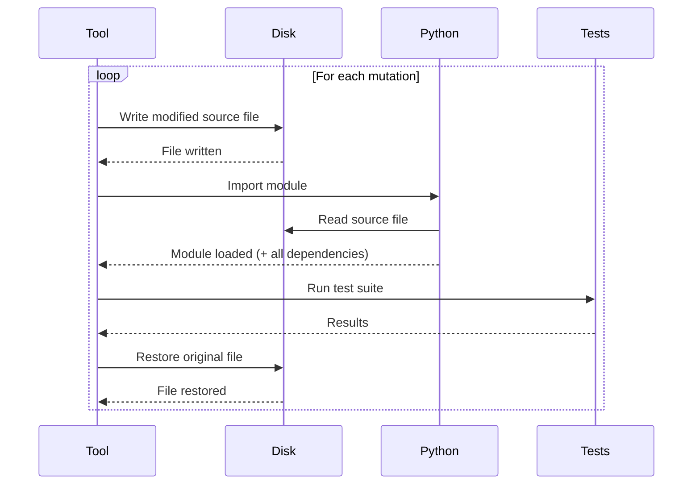
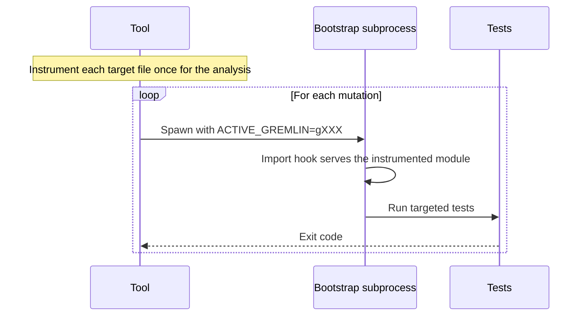
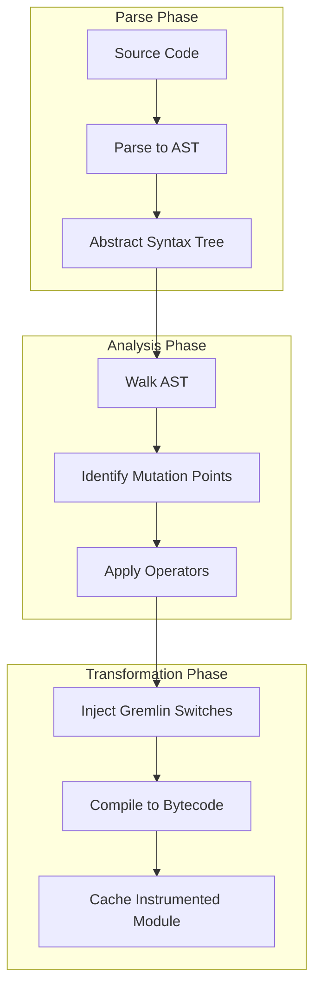

# Mutation Switching

Mutation switching is the foundation of pytest-gremlins' speed architecture. It embeds every
mutation for a source file in one instrumented version of that file, then selects a mutant at
runtime instead of writing a separate source file for each one.

## The Problem with Traditional Mutation Testing

Traditional mutation testing tools follow this pattern:



For a project with 1,000 mutations, this means:

- 1,000 file writes
- 1,000 file restores
- 1,000 module imports (including transitive dependencies)

In Python, imports are expensive. Loading numpy takes hundreds of milliseconds. Loading a
Django application can take seconds. Multiply that by 1,000 mutations and you understand
why traditional mutation testing takes hours.

## How Mutation Switching Works

Mutation switching takes a fundamentally different approach: instrument the code once with
**all mutations embedded**, then use an environment variable to select which mutation
is active.

### Instrumentation Example

Consider this simple function:

```python
# Original code
def is_adult(age):
    return age >= 18
```

pytest-gremlins instruments it to:

```python
# Instrumented code
import os as __gremlin_os__

def is_adult(age):
    __gremlin_id__ = __gremlin_os__.environ.get('ACTIVE_GREMLIN', '')

    if __gremlin_id__ == 'g001':
        return age > 18    # Mutation: >= to >
    if __gremlin_id__ == 'g002':
        return age <= 18   # Mutation: >= to <=
    if __gremlin_id__ == 'g003':
        return age < 18    # Mutation: >= to <
    if __gremlin_id__ == 'g004':
        return age == 18   # Mutation: >= to ==

    return age >= 18  # Original behavior
```

### Activating Mutations

To test a gremlin, pytest-gremlins starts a pytest subprocess for the gremlin's selected tests
with `ACTIVE_GREMLIN=<gremlin id>` in its environment. In that subprocess an import hook serves
the instrumented code, which checks the variable and executes the mutated path. No file is
modified on disk.

Setting `ACTIVE_GREMLIN` yourself on a plain `pytest` run does nothing: without `--gremlins`,
no instrumented code is loaded.

### The Flow



Each target file is instrumented once for the analysis. Each mutation is then tested by starting
a subprocess with a different `ACTIVE_GREMLIN` value, so the source file on disk is never
rewritten and the mutation set does not have to be rebuilt. The full per-gremlin sequence,
including test selection and the cache, is in
[The Gremlin Execution Loop](gremlin-execution-loop.md).

## Why This Is Faster

The saving comes from doing the mutation analysis once per file and choosing a smaller set of
tests for each gremlin. It does not come from eliminating file I/O or process startup.

### Instrument Each Target File Once per Run

Pytest-gremlins parses each target file and embeds every mutation for that file in one
instrumented AST. It writes the instrumented tree or source to `sources.json` in a temporary
directory, next to the `gremlin_bootstrap.py` script. This normally happens after test
collection; under pytest-xdist it happens at the end of the run, once the controller has the
worker item ids. Either way, each target file is processed once for the analysis, and a later
gremlin for the same file reuses that instrumented representation instead of rewriting the file
or rebuilding the file's mutation set.

The switch is part of the generated code. The module reads `ACTIVE_GREMLIN` into
`__gremlin_active__` when it is imported, and each mutation site compares that value with gremlin
ids before falling through to the original expression or statement.

### Start a Fresh pytest Process for Each Gremlin

The default loop runs each gremlin that needs a verdict in a separate `gremlin_bootstrap.py`
subprocess, with `ACTIVE_GREMLIN` and the selected test node ids. Each subprocess reads
`sources.json` and installs the import hook before pytest or the project's test modules are
imported. When the project imports an instrumented file, the hook compiles and executes its
instrumented tree in that process.

Process startup, interpreter and pytest initialization, project and dependency imports, and
code compilation therefore happen again for every gremlin that runs. Module state and
connections belong to that process and do not carry over to the next gremlin.

### Limit Each Run to Covering Tests

The coverage pre-scan runs the test suite with a context per test and builds a map from source
lines to tests. For each gremlin, the plugin selects the tests that executed its line. If no test
covers the line, or a pre-scan problem disables coverage selection, it runs the whole suite.
Selected tests are ordered by specificity, so pytest's exit-first option can stop at the first
failure. Batch mode uses one union of selected tests across all gremlins awaiting a run, and
passes that same test command to every batch.

This can reduce the test work inside each subprocess, but the reduction depends on the project's
test coverage and structure. When enabled, the incremental cache can replace a subprocess with a
stored verdict if the gremlin, source, selected tests, and settings still match. Pardoned
gremlins and selections with no runnable test also skip the subprocess.

### What Still Happens for Every Gremlin That Runs

- A fresh Python process and pytest session are created.
- The bootstrap reads `sources.json`, and the import system loads the modules and dependencies
  the selected tests need.
- Instrumented modules are compiled and executed in that process.
- The selected tests are collected and run, including their own file and resource I/O.
- Some verdicts need an additional unmutated run to confirm that a collection failure or timeout
  came from the mutation rather than the harness.

The gain is structural: one analysis per file and a focused test selection per gremlin, instead
of rewriting a source file for each mutant and running the whole suite. The size of that gain
depends on the project, so this page makes no claim about a specific speedup.

## Implementation Details

### The Instrumentation Pipeline



### AST Transformation

The transformer walks the AST looking for patterns that operators can mutate:

```python
class GremlinTransformer(ast.NodeTransformer):
    def visit_Compare(self, node):
        # Find all applicable mutations
        mutations = self.get_mutations(node)

        if not mutations:
            return node

        # Build switch statement
        return self.build_switch(node, mutations)

    def build_switch(self, original, mutations):
        # Returns an if-elif chain that checks __gremlin_id__
        # and returns the appropriate mutated expression
        ...
```

### Generated Code Structure

The generated switch follows a consistent pattern:

```python
# Check which gremlin is active
__gremlin_id__ = __gremlin_os__.environ.get('ACTIVE_GREMLIN', '')

# First mutation
if __gremlin_id__ == 'g001':
    <mutated code>

# Second mutation
if __gremlin_id__ == 'g002':
    <mutated code>

# ... more mutations ...

# Original code (default path)
<original code>
```

The original code is always the default path. When no gremlin is active, the code behaves exactly as written.

### Mutation Identifiers

Each mutation gets a unique identifier:

```text
g_<file_hash>_<line>_<col>_<operator>_<variant>

Example: g_a7b3c_42_8_comparison_gt
```

This identifier:

- Is deterministic (same code = same ID)
- Includes location information for debugging
- Encodes the operator and variant

## Handling Edge Cases

### Module-Level Code

Code that runs at import time poses a challenge:

```python
# This runs during import, before any test
CONFIG = load_config()  # <- Can we mutate this?
```

pytest-gremlins handles this by:

1. Identifying module-level expressions
2. Wrapping them in lazy evaluation where possible
3. Flagging unmutable module-level code in reports

### Class and Function Definitions

Definitions themselves are not mutated (that would require reimporting), but code inside them is:

```python
# The class definition is not mutated
class Calculator:
    # But the method body is
    def add(self, a, b):
        return a + b  # <- This can become a - b
```

### Decorators

Decorated functions work correctly because the switch is inside the function body:

```python
@cache
def expensive_calculation(x):
    __gremlin_id__ = ...
    if __gremlin_id__ == 'g001':
        return x * 2  # Mutated
    return x + 1  # Original
```

The decorator wraps the instrumented function, not the original.

## Debugging Instrumented Code

### Investigating a Specific Mutation

There is no command that runs one gremlin by hand; `ACTIVE_GREMLIN=g001 pytest ...` without
`--gremlins` runs the original code. To see which tests a gremlin ran and why, pass its full id
(from the progress lines or the JSON report's `gremlin_id`) to `--gremlin-explain`:

```bash
pytest --gremlins --gremlin-explain=calculator_e336_g001
```

## Comparison with File-Based Mutation

| Aspect | File-Based | Mutation Switching |
|--------|------------|--------------------|
| Source file per mutation | Rewritten, then restored | Left unchanged |
| Mutation setup | Repeated for each source file change | All mutations for a file embedded in one instrumented AST |
| Module loading per gremlin | A fresh process imports the rewritten file | A fresh process imports the instrumented file through the hook |
| Process state | Reset for each mutant | Reset for each gremlin |
| Parallelization | Requires coordination around shared source files | Workers assign gremlin ids and spawn independent processes |
| Debugging | Easy (one mutation at a time) | Slightly harder (all embedded) |
| Code readability | Original preserved | Instrumented harder to read |

## Limitations

### Increased Memory Usage

All mutations are in memory at once. For large codebases with many mutations, this can
increase memory usage. In practice, the overhead is modest - a few bytes per mutation point.

### Slightly Larger Bytecode

Instrumented code is larger than original code. This has minimal performance impact but
may affect bytecode cache sizes.

### Compilation Time

Parsing and transforming each target file adds work before the first gremlin. The instrumented
tree is then compiled and executed in each gremlin subprocess that imports the file.

### Interaction with pytest's Assertion Rewriting

The gremlin finder is moved back to the front of `sys.meta_path` after pytest installs its assertion-rewrite
hook but before any `conftest.py` or test module is imported. Modules that hook would rewrite (a `conftest.py`,
a file matching `python_files`, a package passed to `pytest.register_assert_rewrite`) are instrumented and
keep pytest's assertion rewriting, so their assert messages are unchanged. Two exceptions: an assert whose
condition is nested too deeply to split per gremlin is still rewritten, but its failure message shows no
operand values; and a module too deeply nested to parse runs with asserts that pytest did not rewrite. Plugins that
pytest imports earlier, through `-p`, entry points or `PYTEST_PLUGINS`, are already loaded by then and cannot
be instrumented.

## Inspiration and Prior Art

Mutation switching was pioneered by [Stryker](https://stryker-mutator.io/) for JavaScript. Stryker 4.0 reported:

> "Mutation switching can give a performance boost of up to 20-70%"

Mutation switching is a general technique; its effect in a Python project depends on how its
mutation tool implements the switch, how its test suite is structured, and how often a source file
would otherwise be rewritten and reimported.

## Summary

Mutation switching is the foundation that makes everything else possible:

- **Speed:** Each file is instrumented once for the analysis, and coverage guidance narrows each
  gremlin's test run. A gremlin that runs still pays for a fresh process, imports, and I/O.
- **Parallelization:** Workers assign gremlin ids and spawn independent bootstrap processes.
- **Simplicity:** Original source files are never rewritten. The bootstrap and `sources.json`
  live in a temporary directory cleaned up during normal pytest teardown.
- **Stability:** Original files are never modified.

Combined with coverage guidance, incremental analysis, and parallel execution, mutation
switching transforms mutation testing from an overnight CI job into a tool you can use
during development.
